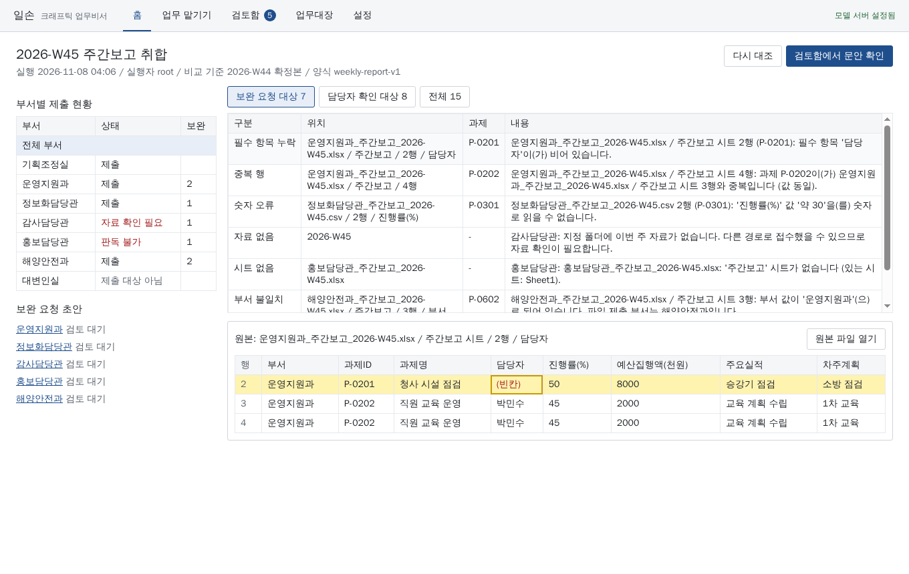
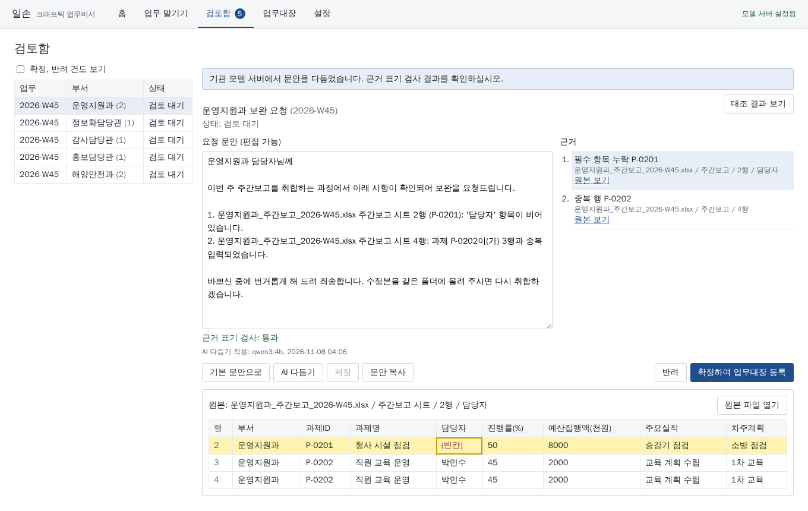
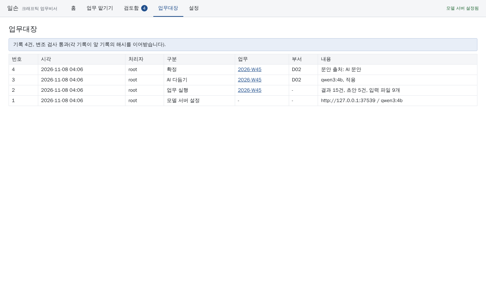
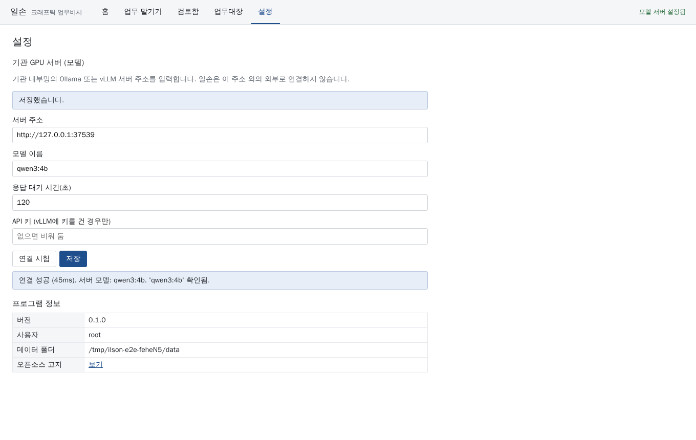

# 일손 (ILSON)

크래프틱 업무비서. 공공기관 담당자가 내부 자료로 처리하는 반복 업무를 맡기는 폐쇄망 설치형 AI 비서다.
1차 업무는 주간보고 취합이다.

담당자 PC(Windows)에 설치하는 프로그램 하나로 동작하고, 모델은 기관 내부망 GPU 서버(Ollama 또는 vLLM)에 연결한다.

## 구성

| 경로 | 내용 | 상태 |
| --- | --- | --- |
| `apps/desktop/` | Windows 데스크톱 앱(Electron). 설치 파일(`Ilson-Setup-*.exe`)과 무설치 실행 파일(`Ilson-Portable-*.exe`) | 0.1.0 |
| `packages/service/` | 업무 실행, 검토함, 업무대장(해시 사슬), 기관 모델 서버 연결 | 0.1.0 |
| `engine/` | OpenClaw 실행 엔진 버전 고정 정보 (`openclaw.pin.json`). 포크하지 않고 공개 릴리스를 그대로 쓴다. | 2026.11.1 고정, 앱 내장은 예정 |
| `plugins/ilson-collate/` | 주간보고 대조 엔진. 제출 명단, 지난주 확정본, 이번 주 파일을 결정적 코드로 대조하고 부서별 보완 요청 초안을 만든다. | 0.1.0 |
| `fixtures/weekly-report/` | 가상 시험 자료와 사람이 작성한 정답표 (`expected.json`) | 2026-W45 |
| `security/` | 차단망 설치, 프롬프트 주입, 권한 회수 시험 | 예정 |
| `docs/` | 설계 결정 기록 | |

## 개발

Node 22 이상, pnpm 10.

```bash
pnpm install
pnpm typecheck
pnpm test
pnpm build
```

데스크톱 앱 실행(개발):

```bash
pnpm --filter @ilson/desktop start
```

Windows 설치 파일은 GitHub Actions `desktop-windows` 작업이 만든다. 작업 결과의 `ilson-windows-x64` 묶음에 설치 파일과 무설치 실행 파일이 들어 있다.
Windows PC에서 직접 만들 때:

```bash
pnpm install
pnpm --filter @ilson/desktop dist:win
```

화면 흐름 자동 시험(Linux는 가상 화면 필요):

```bash
xvfb-run -a node apps/desktop/e2e/smoke.mjs out/shots
```

시험 자료를 다시 만들 때:

```bash
pnpm fixtures
```

대조 엔진만 명령줄로 실행(개발, 시험용):

```bash
node plugins/ilson-collate/dist/cli.js \
  --config fixtures/weekly-report/template.json \
  --roster fixtures/weekly-report/roster.csv \
  --inbox fixtures/weekly-report/inbox/2026-W45 \
  --week 2026-W45 \
  --previous fixtures/weekly-report/confirmed/2026-W44_주간보고_확정본.xlsx \
  --previous-week 2026-W44 \
  --out out/2026-W45
```

결과: `report.json` (전체 결과와 원본 위치), `report.md` (검토함 요약), `requests/<부서>.txt` (보완 요청 초안).

## 라이선스 고지

실행 엔진 OpenClaw는 MIT 라이선스다. 설치본에 포함할 때 저작권과 허가 고지를 보존한다.
모델 가중치, 플러그인, 문서 변환기와 의존성은 반입 전에 각각의 배포 조건과 SBOM을 확인한다.

## 화면

| 화면 | |
| --- | --- |
| 취합 결과와 원본 미리보기 |  |
| 검토함 (AI 다듬기, 근거 표기 검사) |  |
| 업무대장 (변조 검사) |  |
| 설정 (기관 GPU 서버 연결) |  |

화면은 `apps/desktop/e2e/smoke.mjs`가 가상 시험 자료와 시험용 모델 서버로 자동 캡처한 것이다.
